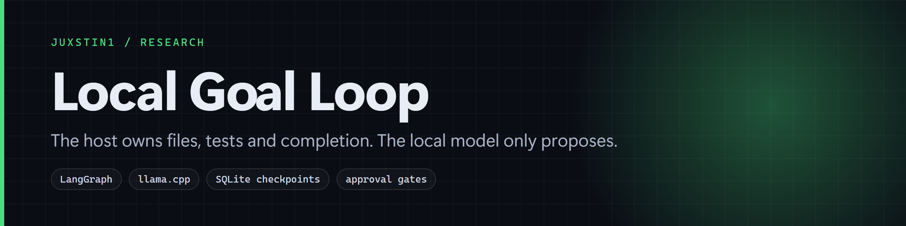
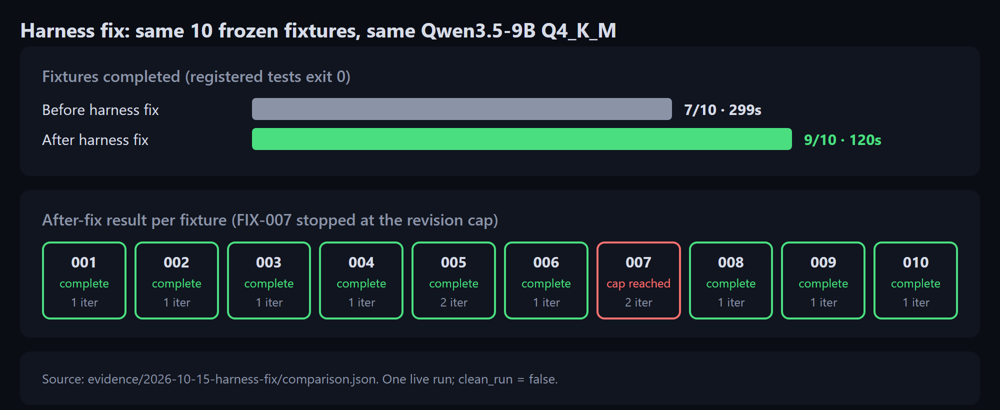

<p align="center"></p>

**A local-model engineering loop where the host owns files, tests and completion, and the model only proposes.**

<p align="center"></p>

*Same 10 frozen fixtures, same local Qwen3.5-9B Q4_K_M, before and after a harness fix. Built from [`comparison.json`](evidence/2026-10-15-harness-fix/comparison.json).*

## What it does

- Runs a LangGraph loop: plan, approve, patch, approve, test, review, stop at a bounded revision limit.
- The model proposes structured plans, replacement files and reviews.
- The host reads files, hashes originals, runs registered tests and decides completion.
- Approval gates follow the plan and the patch.
- Progress is saved in SQLite checkpoints.
- Talks to a local llama.cpp server through an OpenAI-compatible endpoint.

## Results

- Harness fix, 10 frozen fixtures, one live run: 7/10 before, 9/10 after. Time dropped from 299 s to 120 s. Source: [`comparison.json`](evidence/2026-10-15-harness-fix/comparison.json).
- The remaining failure is FIX-007. The model lowercased output keys but counted the original case-sensitive input, and repeated the error on its one revision. pytest failed and completion stayed false.
- The run is not a clean run (`clean_run: false`). It makes no claim of general repository capability or statistical reliability.
- **Failed experiment: LoopObservatory.** A model-authored desktop app built through the loop over seven build attempts. It failed acceptance: 20/24 tests passed, and clicking and scrolling were broken.
- The small test suite that passed first was not enough evidence. Defects: [`HANDOFF.txt`](experiments/LoopObservatory/HANDOFF.txt). Build record: [`build-summary.json`](experiments/LoopObservatory-build/build-summary.json), [model outputs](experiments/LoopObservatory-build/MODEL-OUTPUTS.txt).
- Observatory totals: 39 call records, 36,376 reported output tokens, 578.38 s summed ticket runtime. Supervised.
- A completion receipt proves only that the supplied tests passed.

## How it works

```
objective -> plan -> approval -> patch -> approval -> registered tests -> review
                ^                                                          |
                +------------- revise, up to the bound --------------------+
```

1. The host fixes the goal contract from the objective and the registered tests.
2. The model sees the contract, the test source and the write restrictions.
3. The host checks hashes and applies approved files only.
4. The host runs the registered tests and checks protected files before and after.
5. Completion needs unchanged registered tests passing with receipts cited.

## Quick start

Needs Python 3.12 and uv. The 115 tests are deterministic and use no model.

```powershell
uv sync --frozen
uv run pytest
uv run ruff check src tests scripts
```

Live runs need your own llama.cpp server and GGUF model. Weights are not included.

```powershell
$env:LOCAL_MODEL_BASE_URL = 'http://127.0.0.1:8089/v1'
$env:LOCAL_MODEL_NAME = 'qwen3.5-9b-q4km'
uv run graph-engineer demo --auto-approve
uv run graph-engineer evaluate --receipt-path .runtime/evaluation.json
```

Commands: `probe`, `demo`, `evaluate`. Omit `--auto-approve` to review the gates. More setup notes and provenance: [docs/DETAILS.md](docs/DETAILS.md).

## Layout

- `src/graph_engineer/`: graph, model client, packets, execution, CLI.
- `tests/`, `fixtures/`: deterministic tests and frozen tasks.
- `scripts/`: server launch and evidence collection.
- `evidence/`: harness-fix receipts, traces and checkpoints.
- `experiments/LoopObservatory*/`: the failed app and all build attempts.
- `docs/`: specification, evaluation proof, extended notes.

## Status

- Engine, fixtures and evidence are in place.
- 9/10 fixtures completed in the latest recorded run. One failed.
- The Observatory app does not work and is kept as evidence.
- Next: fix FIX-007 and the Observatory defects listed in HANDOFF.txt.

## License

See [LICENSE](LICENSE).
